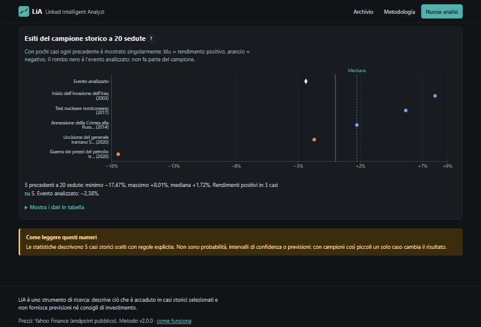
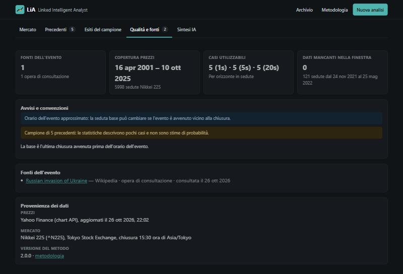

# LiA — Linked Intelligent Analyst

**An interactive tool that shows how stock markets moved around a documented event — and how they moved after similar events in the past.**

[](https://github.com/Marco17Cherubini/Linked-IA/actions/workflows/ci.yml)


> The user interface is in Italian: LiA started as an academic project at the University of Eastern Piedmont (UNIUPO).

---

## The story

### Context

LiA was born from a simple question: **when something big happens — a war, a central-bank decision, a bank failure, an election — what do the markets actually do, and has it happened before?** The answer is usually scattered across news articles, price charts and memory. LiA puts the event, the prices and the historical precedents in one place.

### The problem

The first prototype tried to answer with a chain of language models: it scraped news, asked an LLM to write a free-text "link" between the article and the prices, and compared those texts by shared words. A review of the code showed that the results could not be trusted:

- some indicators used **prices from after the event** as if they were known at the time;
- "historical patterns" were searched in the whole archive, **including later events and the article itself**;
- provider errors were silently turned into "no news" or zero values, and some missing prices were **asked to an LLM**;
- every analysis called the paid model several times, and the API key was written in the source code.

### How we solved it

We rebuilt LiA around data that can be checked:

- **an event is structured data** — date, time with time zone and precision, category, tags and sources — not a scraped paragraph;
- **for each market LiA finds the last close before the event** and measures everything from there, keeping what was known at that moment separate from what happened next;
- **precedents are chosen with explicit rules**, and only if their outcome was already observable on the event date;
- **AI is optional**: a written summary is generated only on explicit request and only from the computed data.

Exploring a case takes three steps: open an event, look at the market around it, compare it with its precedents.

| 1. Open an event                                                                                 | 2. Read the market around it                                                                                   | 3. Compare with precedents                                                                          |
| ------------------------------------------------------------------------------------------------ | -------------------------------------------------------------------------------------------------------------- | --------------------------------------------------------------------------------------------------- |
|  |  |  |

### Results

- **34 real events** from 2001 to 2025 — wars, terror attacks, financial crises, central-bank decisions, elections, tariffs, pandemics, natural disasters — each with verified sources;
- **5 indices** (S&P 500, Nasdaq Composite, DAX 40, FTSE 100, Nikkei 225), about **6,100–6,250 trading sessions each**;
- computed values checked against known closes: the S&P 500 closed at **4,225.50 on 23 February 2022** and gained **+1.50%** the next day, while the DAX fell **−3.96%**; before 11 September 2001 the S&P 500 closed at **1,092.54** and the market stayed shut until the 17th — LiA flags the closure.

| Outcomes of the precedents                                                                                  | Data quality and sources                                                                     |
| ----------------------------------------------------------------------------------------------------------- | -------------------------------------------------------------------------------------------- |
|  |  |

---

## What makes it different

LiA is not a news feed or a price chart: every feature exists to make the link between an event and the markets readable and honest.

### The base session: time zones taken seriously

An event at 22:00 in New York happens the next morning in Tokyo, before the close. For every index LiA finds the **last session that closed before the event**, using each exchange's time zone and closing time (including the Tokyo change to 15:30 in November 2024). When the time is unknown it applies a **cautious convention** — the last session before the event date — and says so on screen.

### Known then vs. happened later

Inputs available at the cutoff (the price path up to the base session and indicators such as 20-session volatility or distance from the 60-session high) are kept apart from outcomes (returns after 1, 5 and 20 sessions). The **"Al cutoff" view** hides everything after the event: the server does not even send it.

### Precedents without hindsight

Precedents share the category or at least two tags with the event, are ranked by a declared score, and are admitted **only if their 20-session outcome was observable on the event's base session**. Each one opens with its date, the reason it was selected, its returns and its sources.

### Statistics that admit their size

Median and quartiles appear only when the sample is large enough (3 and 5 cases). Small samples are drawn **case by case**, larger ones as a histogram. The share of rises is labelled as an **observed frequency, not a probability**, and no band is drawn as if it were a forecast interval.

### Every chart has a text version

Each chart comes with a written summary and a data table, definitions are one click away next to every metric, and the charts can be explored with the keyboard. Light and dark themes, reduced motion and phone layouts are supported.


### Analyses you can reopen and share

Every analysis is saved with the method version and a snapshot of the event, so **reopening it shows exactly the same result**. Market, view, window, horizon and selected precedents live in the URL. Jobs keep running on the server if the page is reloaded.

### AI only when asked

An authorised analyst can request a written summary. It costs money, so it needs **explicit confirmation**, runs once per analysis within a daily limit, receives only the computed data and must answer with a fixed, validated structure. Browsing, filtering or switching markets never calls the model.

### Searchable archive

All saved analyses can be filtered by text, category, status and date, with pagination.


---

## Under the hood

### Tech stack

| Layer       | Choice                                         | Why                                                                                     |
| ----------- | ---------------------------------------------- | --------------------------------------------------------------------------------------- |
| Server      | Python + Flask                                 | Small API over a deterministic domain layer; the same services serve the API and the CLI |
| Database    | SQLite (standard library `sqlite3`)            | One file, transactions, job state that survives restarts; no service to run             |
| Market data | Yahoo Finance public chart endpoint            | Free daily prices for the five indices; timeouts, limited retries, validation, cooldown |
| AI          | DeepSeek (OpenAI-compatible, JSON mode)        | Optional summary, only on explicit request                                              |
| Frontend    | React 18 + Vite + React Router                 | Interactive workspace with state in the URL                                             |
| Charts      | Recharts 3                                     | One declarative SVG library for line, dot and histogram charts                          |
| Tests       | pytest (network blocked) + Vitest              | Offline, no keys, no costs                                                              |

### Architecture

```
frontend/ (React)                         linkedia/
  pages/          home, archive,            api/          Flask routes, errors, security headers
                  methodology, new          cli.py        seed · analyze · events · serve
  features/       workspace, charts,        services/     analyses, AI summary, background jobs
    analysis/     panels, job polling       domain/       markets, sessions, indicators,
  components/     controls, tabs, states                  precedents, statistics (pure, no I/O)
  styles/         tokens → base →           providers/    Yahoo prices, DeepSeek (timeouts, retries)
                  components → pages        storage/      SQLite: events, prices, analyses
        fetch JSON  ─────────────────▶
```

Routes only translate HTTP; the method lives in `domain/`, which has no I/O. Errors have stable codes (400/403/404/409/502/503) and a message for the user; diagnostic details stay in the server logs.

### Quality and security

- **47 offline backend tests** with the network blocked: event-to-session convention across time zones, indicators, minimum sample sizes, precedent cutoff, provider failures, API contracts, persistence, restart recovery and cost controls on the AI summary. **14 frontend tests** cover formatting, chart scales, form payloads and the as-of view.
- An optional smoke test checks the real price provider against a known close.
- No secrets in the source code; analyst token compared in constant time and never put in URLs; debug off by default; Content Security Policy; request size limit.
- GitHub Actions runs lint, tests and the production build on every push (Python 3.11 and 3.12, Node 22).

---

## Getting started

Requirements: **Python 3.11 or newer** and **Node.js 20 or newer**.

```bash
git clone https://github.com/Marco17Cherubini/Linked-IA.git
cd Linked-IA
python -m venv .venv
.venv/Scripts/python -m pip install -e ".[dev]"   # Linux/macOS: .venv/bin/python
cd frontend && npm ci && npm run build && cd ..
```

Load the catalogue and start the app:

```bash
.venv/Scripts/python -m linkedia seed    # downloads free prices, computes the 34 analyses
.venv/Scripts/python -m linkedia serve   # http://127.0.0.1:5000
```

No command calls a paid service. Without any configuration LiA runs in read-only mode.

### Useful commands

| Command                               | What it does                                                   |
| ------------------------------------- | -------------------------------------------------------------- |
| `python -m linkedia seed`             | Import the curated catalogue, sync prices, compute analyses    |
| `python -m linkedia analyze <id>`     | Recompute the analysis of one event                            |
| `python -m linkedia events`           | List the events in the database                                |
| `python -m linkedia serve`            | Development server on 127.0.0.1:5000                           |
| `python -m pytest` / `ruff check .`   | Offline tests and lint                                         |
| `python -m pytest -m external`        | Smoke test against the real price provider                     |
| `npm run dev` (in `frontend/`)        | Frontend with hot reload on port 5173, proxying `/api`         |
| `npm test` / `npm run build`          | Frontend tests and production build                            |

### Configuration

Copy `.env.example` to `.env`. Every variable is optional.

| Variable              | Default                  | Purpose                                                           |
| --------------------- | ------------------------ | ----------------------------------------------------------------- |
| `LIA_ADMIN_TOKEN`     | —                        | Enables creating analyses and requesting AI summaries             |
| `DEEPSEEK_API_KEY`    | —                        | Enables the AI summary (paid), together with the token            |
| `DEEPSEEK_MODEL`      | `deepseek-chat`          | Model used for the summary                                        |
| `LIA_AI_DAILY_LIMIT`  | `20`                     | Maximum summaries in 24 hours                                     |
| `LIA_DATABASE_PATH`   | `instance/lia.sqlite3`   | SQLite file (relative paths start from the project root)          |
| `LIA_FRONTEND_DIST`   | `frontend/dist`          | Built frontend served by Flask                                    |
| `LIA_FEATURED_EVENT`  | `russia-invades-ukraine-2022` | Demo case on the home page                                  |
| `LIA_HTTP_TIMEOUT`    | `20`                     | Timeout in seconds for external providers                         |
| `LIA_LOG_LEVEL`       | `INFO`                   | Log level                                                         |
| `LIA_DEBUG`           | `false`                  | Local development only                                            |

### Deployment

The `Dockerfile` builds the frontend and runs Gunicorn as **one process** (background jobs live in the process, their state in SQLite). Mount a persistent volume on `/data`, set a strong `LIA_ADMIN_TOKEN` and serve the app behind HTTPS:

```bash
docker build -t lia .
docker run -p 8000:8000 -v lia-data:/data --env-file .env lia
docker run --rm -v lia-data:/data lia python -m linkedia seed
```

The image has not been run yet: it was written in an environment without Docker.

---

## Development

Before pushing, run `ruff check .`, `python -m pytest` and, in `frontend/`, `npm test` and `npm run build` — the same checks run in CI.

- **Domain**: `linkedia/domain/` is pure — no network, files or imports from the rest of the package. Changing a formula, a time convention or the precedent rules means bumping `METHOD_VERSION` and updating the Methodology page and the tests.
- **Errors**: provider failures are `ProviderUnavailable` and are never turned into empty lists or zeros; missing values stay `null` with a reason.
- **Frontend**: view state lives in the URL (`useUrlState`); definitions shared by charts and the Methodology page are in `src/content/glossary.js`; colours come from tokens so both themes keep their contrast.
- **AI**: paid calls happen only through `POST /api/analyses/:id/summary` with `confirm_cost`, never in tests or in `seed`.
- User-facing text and code comments are in Italian. Architecture and API contracts are in [docs/architecture.md](docs/architecture.md), decisions in [docs/decisions/](docs/decisions/).

## Known limitations

- **Small samples**: the catalogue is curated and small, so each event has only a handful of precedents. The interface says so, but the numbers describe a few cases, not a general law.
- **Correlation, not causation**: other news moves markets in the same days as the event.
- **Unofficial price source**: the Yahoo endpoint is public but not an official API; gaps and errors are flagged, never filled.
- **Reference sources**: catalogue sources are encyclopedia entries and official statements, not original reports from the time.
- **Market hours**: early closes and historical changes of closing time (except Tokyo 2024) are not modelled; approximate event times can shift the base session when they fall near a close.
- **No out-of-sample validation**: semantic similarity and forecasting models are deliberately out of scope until the method can be evaluated.

## Project structure

```
linkedia/      Python package: domain, providers, storage, services, api, cli, data/events.json
frontend/      React app: pages, features/analysis, components, styles, tests
tests/         pytest suites (offline) and the optional external smoke test
docs/          architecture, decisions, refactoring plan, images, history of the first prototype
```

## Author

Designed and built by **Marco Cherubini** — [github.com/Marco17Cherubini](https://github.com/Marco17Cherubini).

## License

No license has been chosen yet: all rights are reserved until a `LICENSE` file is added.
